<p align="center">
  
</p>

<h1 align="center">Monsmith</h1>

<p align="center">
  <b>The audit layer for Monad.</b><br/>
  An AI auditor agent that audits and fixes smart contracts, then attests every audit on Monad mainnet under its own ERC-8004 identity, so any wallet, agent or contract can check code before it calls it.
</p>

<p align="center">
  <a href="https://www.monsmith.com/studio"><b>Live product</b></a> ·
  <a href="https://www.monsmith.com/verify"><b>Verify a contract</b></a> ·
  <a href="https://www.monsmith.com/github"><b>Review every pull request</b></a> ·
  <a href="https://youtu.be/amRA1dh4zBw"><b>Demo video</b></a> ·
  <a href="https://youtu.be/TtPaZDOJ-r8"><b>Pitch video</b></a> ·
  <a href="https://www.monsmith.com/agent.json"><b>Agent card</b></a>
</p>

<p align="center">
  
  
  
  
  
  
</p>

<p align="center">
  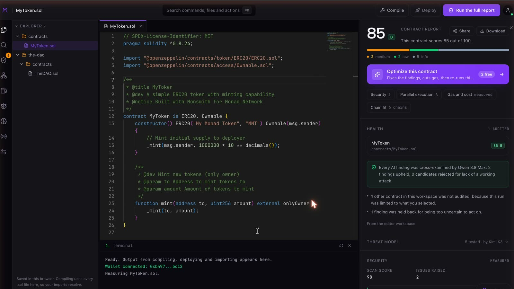
</p>

---

## Contents

- [Metropolis entry at a glance](#metropolis-entry-at-a-glance)
- [Videos](#videos)
- [Judges: see it working in 60 seconds](#judges-see-it-working-in-60-seconds)
- [Monsmith on every pull request](#monsmith-on-every-pull-request)
- [Usage so far](#usage-so-far)
- [The problem](#the-problem)
- [How Monsmith works](#how-monsmith-works)
- [Architecture](#architecture)
- [The life of one audit](#the-life-of-one-audit)
- [Every sponsor, and the job it does](#every-sponsor-and-the-job-it-does)
- [Build on Monsmith: verify before you call](#build-on-monsmith-verify-before-you-call)
- [Onchain proof, Monad mainnet](#onchain-proof-monad-mainnet)
- [Repository map](#repository-map)
- [Tech stack](#tech-stack)
- [What existed before Metropolis and what was built during it](#what-existed-before-metropolis-and-what-was-built-during-it)
- [Run it](#run-it) · [Tests](#tests) · [AI tools used](#ai-tools-used) · [Attribution](#attribution) · [Author](#author)

---

## Metropolis entry at a glance

**Primary track: Trust, Identity & AI Infrastructure.** Monsmith is a trust primitive other apps build on. An agent with its own ERC-8004 identity audits code and writes a signed record of each audit to Monad: the source hash, the score and the hash of the full report. Anyone can check that record with one contract read or one HTTP call. A Chainlink DON independently re-checks each record, and Envio indexes the whole history.

**Sponsor bounties: 10.** Each one does a real job in the product, and each has onchain proof or a working demo.

| Bounty | The job it does in Monsmith | Proof | Video |
| --- | --- | --- | --- |
| [**Chainlink CRE**](#chainlink-cre-an-independent-second-opinion-on-every-audit) | A DON re-checks every attestation and writes a signed verdict to Monad; contracts ask `isConfirmed()` | 2 verdicts on mainnet: [`0x0b1b6e7b…`](https://monadvision.com/tx/0x0b1b6e7bd92ea0a220abdc582a542caefb9bd3ceb8eb91d5e8436186c9fec94b), [`0x830d99a0…`](https://monadvision.com/tx/0x830d99a07aa5915e284e7bf9baa670efe0a7b84adeb55aae6be77a3576cca015) | [1:27](https://youtu.be/lCK700aLaYI) |
| [**Envio**](#envio-the-full-audit-history-readable-in-one-call) | HyperIndex over every `Attested` event; powers the public ledger on `/verify` | 11 attestations indexed, live at [`/api/attestations`](https://www.monsmith.com/api/attestations) | [1:02](https://youtu.be/ZEd1WCzPq6A) |
| [**Alchemy**](#alchemy-the-rpc-and-the-code-check-before-a-score-is-bound) | The RPC behind every write and read; checks the code at an address before a score is bound to it | Proxy resolution live on `/api/verify` | [0:54](https://youtu.be/p_NdzhyRUwY) |
| [**Dynamic**](#dynamic-an-mpc-wallet-signs-for-the-agent) | Two-of-two MPC server wallet owns agent #10332 and signs every attestation | Identity moved in [`0x700c0568…`](https://monadvision.com/tx/0x700c05686de63291bcf98570dfb61f1ba6d991dbe59ece32a80f92cdd089dc64) | [0:59](https://youtu.be/d1GNPTCjaDc) |
| [**Privy**](#privy-sign-in-and-a-monad-wallet-in-one-step) | Account layer plus an embedded Monad wallet per account that deploys from the browser | Mainnet deploy from a Privy wallet: [`0xfe9c2aa5…`](https://monadvision.com/tx/0xfe9c2aa54f60264a37f07a570d94fd3899191ed145704ed93bfb0ccf494f449d) | [1:02](https://youtu.be/5W-U-RZvd6g) |
| [**Mera: One Passkey, Many Keys**](#mera-reports-sealed-to-your-passkey) | Seals audit reports of private code to the reader's passkey: a non-wallet use of PRF keys | Seal and open on [`/open`](https://www.monsmith.com/open), shown end to end | [0:52](https://youtu.be/m4vkMWoiT0Q) |
| [**Nansen**](#nansen-what-is-at-stake) | "What is at stake": what a deployed contract holds and who it deals with, next to its findings | Wrapped MON: $8.2M held, 8 counterparties in 30 days | [0:59](https://youtu.be/dnBJbVOjdLw) |
| [**Kimi**](#kimi-k3-and-qwen-38-max-two-models-that-check-each-other) | Kimi K3 writes the threat model every audit is tested against | [Article](https://www.monsmith.com/learn/kimi-k3-writes-the-threat-model) | in the [demo](https://youtu.be/amRA1dh4zBw) |
| [**Qwen 3.8 Max**](#kimi-k3-and-qwen-38-max-two-models-that-check-each-other) | Cross-examines every finding; may only reject one by citing the line that stops the attack | [Article](https://www.monsmith.com/learn/qwen-3-8-max-cross-examines-audit-findings) | in the [demo](https://youtu.be/amRA1dh4zBw) |
| **Best Community Team Project** | Built by a member of **PU DAO** | | |

---

## Videos

<table>
  <tr>
    <td width="50%" align="center">
      <a href="https://youtu.be/TtPaZDOJ-r8"></a><br/>
      <b>Pitch</b> · 1:47
    </td>
    <td width="50%" align="center">
      <a href="https://youtu.be/amRA1dh4zBw"></a><br/>
      <b>Technical demo</b> · 2:46
    </td>
  </tr>
</table>

| Sponsor clip | Length | | Sponsor clip | Length |
| --- | --- | --- | --- | --- |
| [Chainlink CRE](https://youtu.be/lCK700aLaYI) | 1:27 | | [Privy](https://youtu.be/5W-U-RZvd6g) | 1:02 |
| [Envio](https://youtu.be/ZEd1WCzPq6A) | 1:02 | | [Mera](https://youtu.be/m4vkMWoiT0Q) | 0:52 |
| [Alchemy](https://youtu.be/p_NdzhyRUwY) | 0:54 | | [Nansen](https://youtu.be/dnBJbVOjdLw) | 0:59 |
| [Dynamic](https://youtu.be/d1GNPTCjaDc) | 0:59 | | [Monsmith in 30 seconds](https://youtu.be/kxBy0EDgHuQ) | 0:30 |

Every number in every video is real data from Monsmith and Monad mainnet.

---

## Judges: see it working in 60 seconds

No account needed for the first three steps.

1. Open **[monsmith.com/studio](https://www.monsmith.com/studio)** and press **Check The DAO**. Its full report plays back in seconds: 39 out of 100, a critical reentrancy, and the line to fix.
2. Press **Optimize this contract**. Monsmith rewrites it, re-checks it like a fix review, and the score goes **39 to 79**, with a before and after diff.
3. Open **[monsmith.com/verify](https://www.monsmith.com/verify)**. The ledger, indexed by Envio, lists every audit on Monad. Paste The DAO's source or any address to get its onchain score.
4. To audit your own contract, sign in with Google, GitHub or email. The first two reports and two optimizations are free, and Privy gives you a Monad wallet to deploy with.
5. See the GitHub App review a real pull request: **[monsmith-pr-demo#2](https://github.com/Adwaitbytes/monsmith-pr-demo/pull/2)**. Three pushes, the score from 15 to 41 to 52, six findings fixed before merge, and the merged code [attested on Monad](https://monadscan.com/tx/0x3f4c960954c71e0f026a13622d4be8285b5d3b3b7f0b840e22a82ee9b14537bb).

---

## Monsmith on every pull request

A report is one look at code that changes next week. A mentor put it plainly: the repeat unit for an auditor is the commit. So Monsmith is also a GitHub App. Install it once, and every pull request that changes Solidity gets reviewed on every push.

<p align="center">
  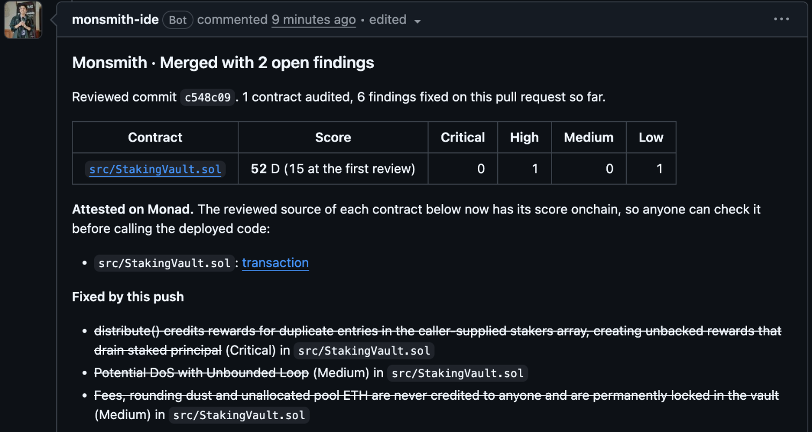
</p>

**What happens on each push**

- **The contracts the pull request changes get a full audit.** It uses the same engine as a report run by hand: the Kimi K3 threat model, the exploit hunt, Qwen 3.8 Max cross-examining every finding, and the static and gas passes. Tests, scripts, dependencies and drafts are skipped. A pull request that touches no Solidity gets no comment at all.
- **One comment, edited in place.** It shows the score per contract and the findings worst first, each linked to its line at the reviewed commit. A check run puts the same findings on their lines in "Files changed", and the check fails while a critical or high finding is open.
- **A later push is a fix review, not a fresh audit.** Each earlier finding is re-checked against the new code, so "fixed" is measured, not two model runs that happened to disagree. The changed contract is then audited again in full, so a fix that breaks something elsewhere is caught. The original invariants are checked against the new code. A new finding that only restates a known one is dropped by a model check, so a push is never blamed for old bugs under new names. Contracts the push did not touch are reused as they were, at no cost.
- **On merge, the reviewed code is attested on Monad.** Monsmith reads the merged files, and only if they are byte for byte what it reviewed does the Dynamic agent wallet write their score to the attestations contract. Anyone can then check it at [`/verify`](https://www.monsmith.com/verify) or with one contract read.

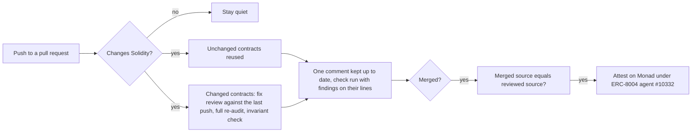

**The numbers it is judged by.** Not comments posted. [`/github`](https://www.monsmith.com/github) shows, live from the database: teams installed, installs still running at week four, pull requests reviewed, findings fixed before merge, fixes merged, and merges attested. The team's own GitHub account is left out of every one of them, so today they read zero. The demo pull request above is ours and is not counted.

**Limits.** Each installation gets 60 reviewed pushes and 10 attestations every 30 days. The app reads contents only on the repositories you pick, and writes only its one comment and its check run. Code lives in [`lib/prReview/`](lib/prReview) and [`app/api/github/webhook/route.ts`](app/api/github/webhook/route.ts).

---

## Usage so far

Since 1 Sep 2026, from Monsmith's own analytics. The author's testing is included, so treat these as a floor on effort, not a claim of customers.

| | |
| --- | --- |
| Visitors | 234 |
| Full audit reports run | 65, by 28 different people or accounts |
| Contracts deployed from the studio | 14 |
| Audits attested on Monad mainnet | 11 |
| Chainlink CRE verdicts on mainnet | 2 |
| Paid reports | none yet; card checkout is live |

---

## The problem

Wallets and AI agents now call contracts nobody on the team has read. If an audit exists at all, it is a PDF on a website, and nothing ties it to the bytes being called. Two things go wrong:

1. **At the moment of the call, nobody can ask** "was this exact code audited, and how did it score?"
2. **Everyone has to trust the publisher** not to edit the audit later.

Monsmith fixes both. The audit is tied to the keccak256 of the code, signed by an agent with an onchain identity, stored on Monad, re-checked by a Chainlink DON, and readable by any contract in one call.

---

## How Monsmith works

| | Step | What happens |
| --- | --- | --- |
| 1 | **Audit** | Paste a contract, import one by address, or pick a GitHub repository. Four AI passes (describe, threat model by **Kimi K3**, attack hunt by **Claude Sonnet 5.5**, cross-examination by **Qwen 3.8 Max**) run next to deterministic static rules, a Monad parallel-execution profile, a gas table, and a cross-chain cost comparison measured by actually running the contract. |
| 2 | **Fix** | **Optimize** rewrites the contract to fix its findings, weighing more than one way to fix each serious finding and naming the alternative it rejected. A fix counts only if it compiles and keeps its interface. Then a fix review runs on the new code: every earlier finding is re-checked, the **whole contract is audited again** (a fix in one place can break something elsewhere, so new findings are kept wherever they sit and labelled), and the **invariants Kimi K3 derived from the original contract are checked against the fixed code**. Download the before and after as a diff. |
| 3 | **Attest** | **Publish to Monad** writes the score, severity counts, source hash and report hash to `MonsmithAttestations`, signed by the agent's **Dynamic** MPC wallet through **Alchemy**. Only the owner of ERC-8004 agent #10332 can write. |
| 4 | **Verify** | `/verify`, `GET /api/verify` and `MonsmithAttestations.ofDeployment` answer "was this audited, and how did it score?" The report is hashed again, so an edited report shows up as edited. **Envio** serves the full history. A **Chainlink CRE** workflow writes an independent verdict, and contracts call `MonsmithVerdicts.isConfirmed`. |
| + | **Around it** | **Privy** accounts with a Monad wallet each, **Mera**-sealed reports for private code, and **Nansen**'s "What is at stake" on deployed contracts. |

<p align="center">
  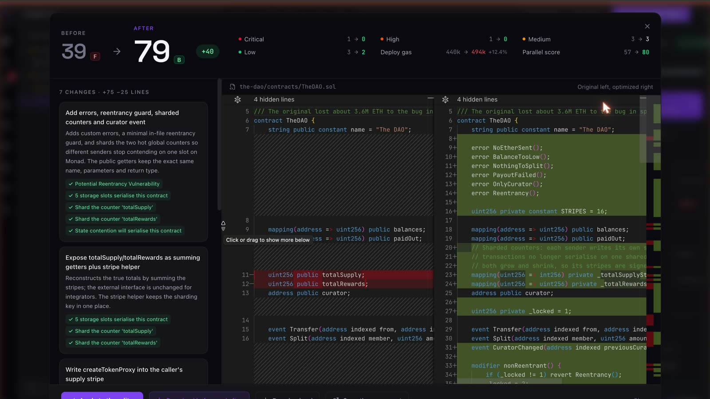
</p>

---

## Architecture

<p align="center">
  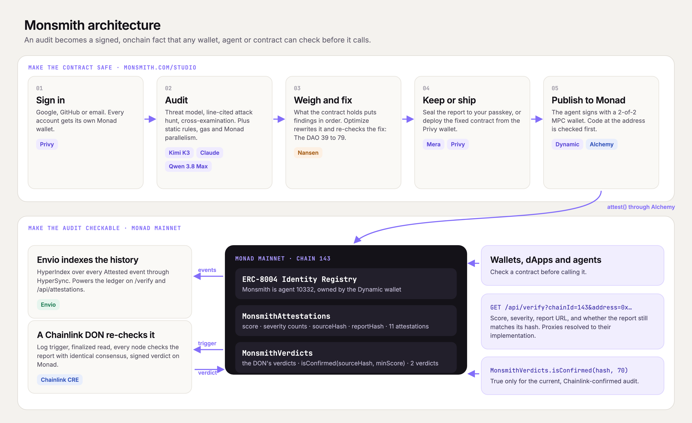
</p>

Top: what a developer does in the studio, and which sponsor does each step. Bottom: what happens on Monad after **Publish**, and how anyone checks it. Source: [`docs/architecture.html`](docs/architecture.html).

---

## The life of one audit

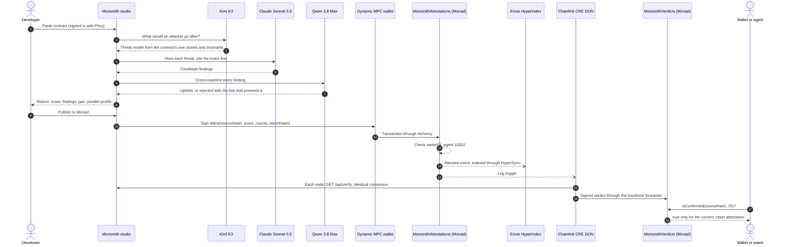

---

## Every sponsor, and the job it does

### Chainlink CRE: an independent second opinion on every audit

**Why.** An attestation is Monsmith's word. A Chainlink DON makes it two: the nodes independently check that the report published today is the one that was attested, and put their verdict on Monad where any contract can read it.

**How.** The workflow in [`cre/attestation-verifier`](cre/attestation-verifier) uses three CRE capabilities:

1. **EVM log trigger** on `Attested` events from `MonsmithAttestations` on `monad-mainnet`.
2. **EVM read** of the attestation that is current at finalized depth (`ofSource`). An event a re-audit has already replaced gets no verdict.
3. **HTTP in node mode with identical consensus.** Every node asks `https://www.monsmith.com/api/verify?source=<hash>` whether the report still hashes to what was attested, and the nodes must agree on intact or altered. A verifier that cannot answer produces no verdict rather than an accusation.

It then writes the signed verdict `(sourceHash, score, reportHash, reportMatches)` through the Keystone forwarder to [`MonsmithVerdicts`](contracts/cre/MonsmithVerdicts.sol). `isConfirmed(sourceHash, minScore)` says yes only when the DON confirmed **the attestation that is current**, so a re-audit is never vouched for by the verdict on the audit before it.

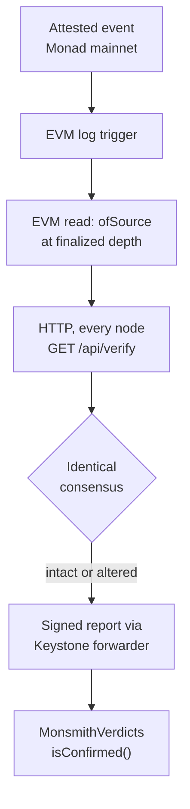

**Proof on Monad mainnet**, both delivered with `cre workflow simulate --broadcast` through CRE's simulation forwarder `0x9eF6468C…784d`:

| Audit | Score | Verdict tx | Check |
| --- | --- | --- | --- |
| The DAO (rebuilt) | 39 | [`0x0b1b6e7b…c94b`](https://monadvision.com/tx/0x0b1b6e7bd92ea0a220abdc582a542caefb9bd3ceb8eb91d5e8436186c9fec94b) | `isConfirmed(DAO, 30)` true, `isConfirmed(DAO, 50)` false |
| MyToken, published from the studio | 85 | [`0x830d99a0…a015`](https://monadvision.com/tx/0x830d99a07aa5915e284e7bf9baa670efe0a7b84adeb55aae6be77a3576cca015) (block 112,457,319) | `isConfirmed(MyToken, 80)` true |

**Code:** `cre/attestation-verifier/`, `contracts/cre/MonsmithVerdicts.sol`, `test/MonsmithVerdicts.test.cjs` · [details](cre/README.md) · **Video:** [1:27](https://youtu.be/lCK700aLaYI)

---

### Envio: the full audit history, readable in one call

**Why.** `MonsmithAttestations` keeps only the latest attestation per source, so the history exists only as `Attested` events. The public Monad RPC answers `eth_getLogs` over at most 100 blocks, and Monad makes about 216,000 blocks a day. Finding the first ten attestations by RPC took 90 calls across 9,000 blocks. Without an indexer, the history cannot practically be read.

**How.** An Envio HyperIndex indexer ([`indexer/`](indexer)) syncs every `Attested` event through HyperSync from the deployment block and keeps four entities:

| Entity | Holds |
| --- | --- |
| `Attestation` | One row per event, with a `reattested` flag for re-audits |
| `AuditedSource` | First and latest score per source |
| `Deployment` | Latest attestation per deployed contract |
| `AgentStats` | Running totals: attestations, sources, average score, criticals found |

`/api/attestations` reads the HyperIndex GraphQL endpoint first and HyperSync directly as a fallback, and the ledger on `/verify` renders it.

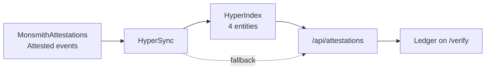

**Proof:** live now, `GET https://www.monsmith.com/api/attestations` returns `"via": "envio-hypersync"` with 11 attestations, 11 sources and an average score of 67.

<p align="center">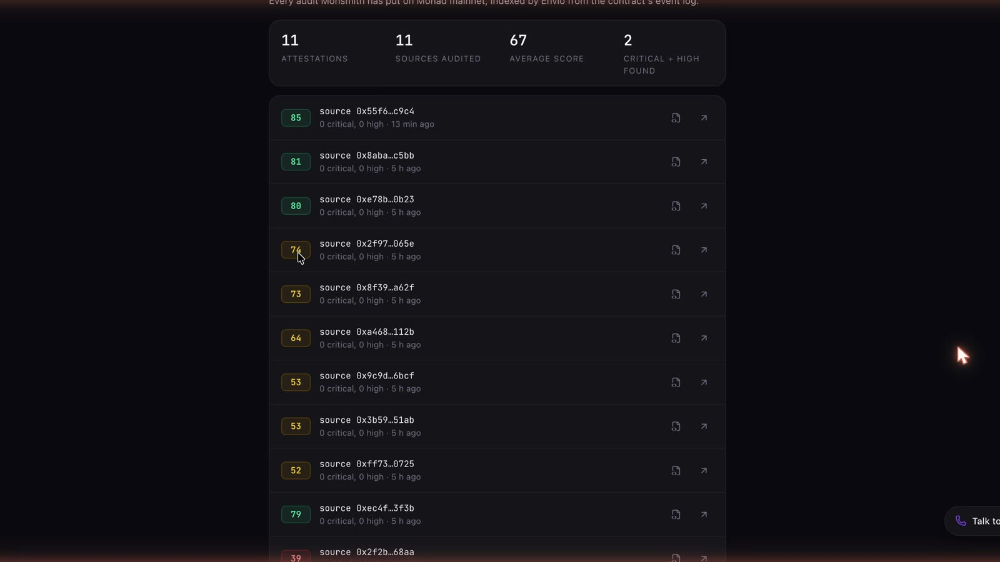</p>

**Code:** `indexer/`, `lib/attest/ledger.ts`, `app/api/attestations`, `app/verify/LedgerFeed.tsx` · **Video:** [1:02](https://youtu.be/ZEd1WCzPq6A)

---

### Alchemy: the RPC, and the code check before a score is bound

**Why.** A score tied to the wrong code is worse than no score. Before Monsmith binds an audit to a deployed address, it has to know what code actually runs there.

**How.** One Alchemy key carries every onchain action of the agent on Monad mainnet, Monad testnet, Ethereum and Sepolia, with the public RPCs as automatic fallback ([`lib/attest/rpc.ts`](lib/attest/rpc.ts)). Through it, Monsmith:

- reads the code at the address (`eth_getCode`); an **empty address is refused**;
- reads the **EIP-1967 implementation slot**; a proxy's score is bound to its source, **never to its repointable address**;
- on `/verify`, resolves a proxy to the implementation it really runs.

**Proof:** `GET /api/verify?chainId=143&address=0xe7cd86e13AC4309349F30B3435a9d337750fC82D` returns `"proxyOf": "0x779Ded0c9e1022225f8E0630b35a9b54bE713736"`.

**Code:** `lib/attest/rpc.ts`, `app/api/report/[id]/attest/route.ts`, `app/api/verify/route.ts` · **Video:** [0:54](https://youtu.be/p_NdzhyRUwY)

---

### Dynamic: an MPC wallet signs for the agent

**Why.** The agent's signing key is the most sensitive thing it owns: whoever holds it can attest anything as Monsmith. A raw private key in a deployment setting is one leak away from that.

**How.** The key is a Dynamic server wallet with a **TWO_OF_TWO** threshold scheme: one key share on Monsmith's server, one with Dynamic, both needed to sign. No machine ever holds the whole key. The wallet owns ERC-8004 agent #10332, and `MonsmithAttestations` checks `ownerOf` on every write, so the Dynamic wallet is the only thing that can attest. Every **Publish to Monad** signs through `@dynamic-labs-wallet/node-evm`'s viem wallet client.

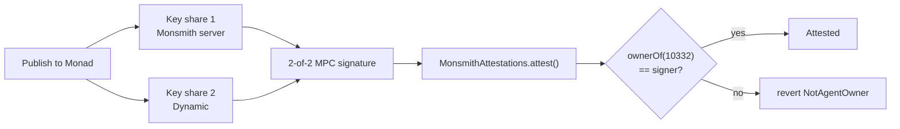

**Proof:** wallet [`0x37E6Be20…A683`](https://monadvision.com/address/0x37E6Be20e5cad8701c0355B38Bc955C46CcCa683) received the identity in [`0x700c0568…dc64`](https://monadvision.com/tx/0x700c05686de63291bcf98570dfb61f1ba6d991dbe59ece32a80f92cdd089dc64) and signed the latest attestation, [`0x1a295209…bcfc`](https://monadvision.com/tx/0x1a295209f50c6a47ea6ca0cc26db496ac814ff78631288c92c63f97e6420bcfc) (MyToken, 85).

**Code:** `lib/attest/signer.ts`, `scripts/dynamic-agent-wallet.mjs`, `scripts/move-identity-to-dynamic.mjs` · **Video:** [0:59](https://youtu.be/d1GNPTCjaDc)

---

### Privy: sign in and a Monad wallet, in one step

**Why.** Most people who could use an audited contract have never installed a wallet. Requiring an extension and a seed phrase before the first deploy loses them.

**How.** Privy is the whole account layer, not just the login:

- **Sign-in** with Google, GitHub or email in Privy's modal. The browser hands Privy's identity token to `/api/auth/session`, which verifies it against Privy's keys and keeps it in an HttpOnly cookie. Every server route reads who is asking, and their role and tier, from a token Privy signed. Admin tier changes write back with `setCustomMetadata`.
- **An embedded Monad wallet for every account**, created at sign-up (`createOnLogin: 'users-without-wallets'`).
- **Deploy from the browser.** The studio signs with an installed wallet when there is one and with the Privy wallet otherwise (`injected ?? embeddedProvider`), and Privy's own modal confirms the transaction.

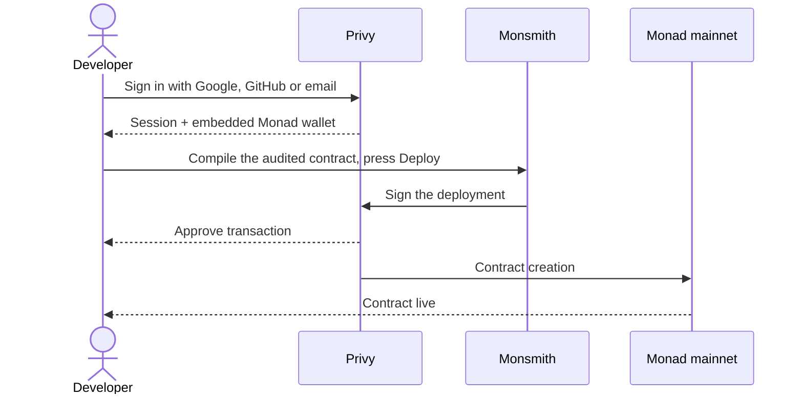

**Proof:** `MyToken` at [`0xe4eA06e0…Ce74`](https://monadvision.com/address/0xe4ea06e01ca0b4cb4044527bdae1de1ecbe7ce74), deployed on Monad mainnet from Privy wallet `0x1259…bd8d` in [`0xfe9c2aa5…449d`](https://monadvision.com/tx/0xfe9c2aa54f60264a37f07a570d94fd3899191ed145704ed93bfb0ccf494f449d) (block 112,617,359).

<p align="center">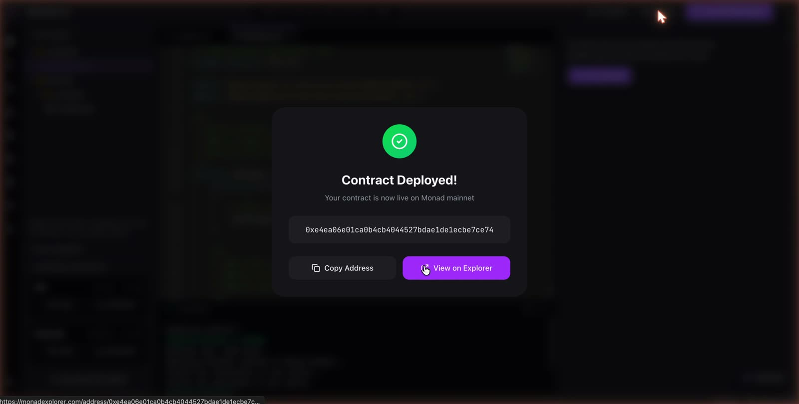</p>

**Code:** `lib/auth/client.tsx`, `lib/auth/privy.ts`, `lib/auth/server.ts`, `app/api/auth/session`, `lib/ethereum.ts` · **Video:** [1:02](https://youtu.be/5W-U-RZvd6g)

---

### Mera: reports sealed to your passkey

**Why.** An audit of private code is itself sensitive: it says exactly where that code breaks. Emailing it as a PDF hands the exploit map to anyone who sees the email.

**How.** A non-wallet use of Mera's PRF-derived key material. From any report, **Download, Sealed to your passkey** encrypts the Markdown report **in the browser** into a Mera secret vault: the passkey's WebAuthn PRF output goes through HKDF to an AES-256-GCM key, with a fresh salt for every file. The first seal creates a Monsmith sealing passkey (rpId `monsmith.com`, so it works on every Monsmith host); later seals reuse it.

The `.sealed.json` carries only the title and date in the clear. It is safe in email, a drive or a public repository, and opens only at [`/open`](https://www.monsmith.com/open) with the passkey that sealed it. Monsmith's servers never see the key or the sealed plaintext.

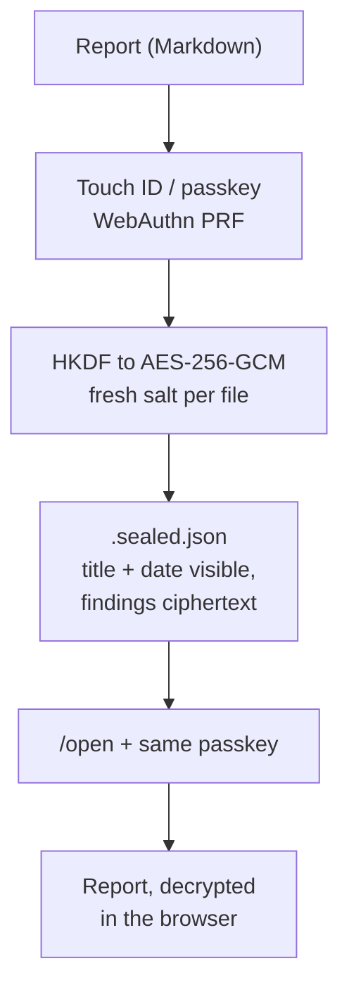

**Proof:** shown end to end in the video: The DAO's report sealed with Touch ID, then opened at `/open`.

<p align="center">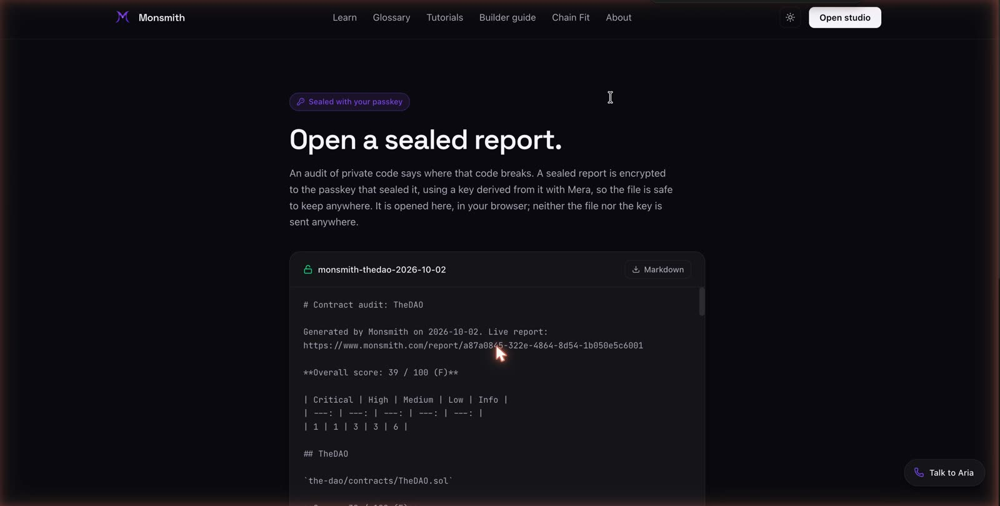</p>

**Code:** `lib/seal/sealedReport.ts`, `app/open`, `app/studio/components/report/ReportDownload.tsx`, `tests/seal-report.test.ts` · **Video:** [0:52](https://youtu.be/m4vkMWoiT0Q)

---

### Nansen: what is at stake

**Why.** A severity label says how bad a bug is. The money behind it says how urgent it is. A critical in a test contract holding nothing is a lesson; the same critical in a contract holding millions is an incident waiting to happen.

**How.** Next to every audit of a deployed contract, on reports and on `/verify`, Monsmith calls two Nansen Profiler endpoints:

| Endpoint | Shows |
| --- | --- |
| `POST /api/v1/profiler/address/current-balance` | What the contract holds now, in USD, by token |
| `POST /api/v1/profiler/address/counterparties` | Who it dealt with over 30 days, with Nansen labels and volume |

It goes beyond showing data: when critical or high findings sit on real money, the report says so in one line (for example, "2 critical or high findings sit on a contract holding $1.2M"), so the developer knows which fix cannot wait. Answers are cached for an hour to respect credits.

**Proof:** wrapped MON on Monad mainnet (`0x3bd359C1…433A`): $8.2M held, 8 counterparties in 30 days.

**Code:** `lib/stake/nansen.ts`, `app/api/stake`, `app/components/StakeCard.tsx` · **Video:** [0:59](https://youtu.be/dnBJbVOjdLw)

---

### Kimi K3 and Qwen 3.8 Max: two models that check each other

**Why.** A single model grading its own findings is not an audit. Monsmith splits the work across model families so each pass is checked by a different one.

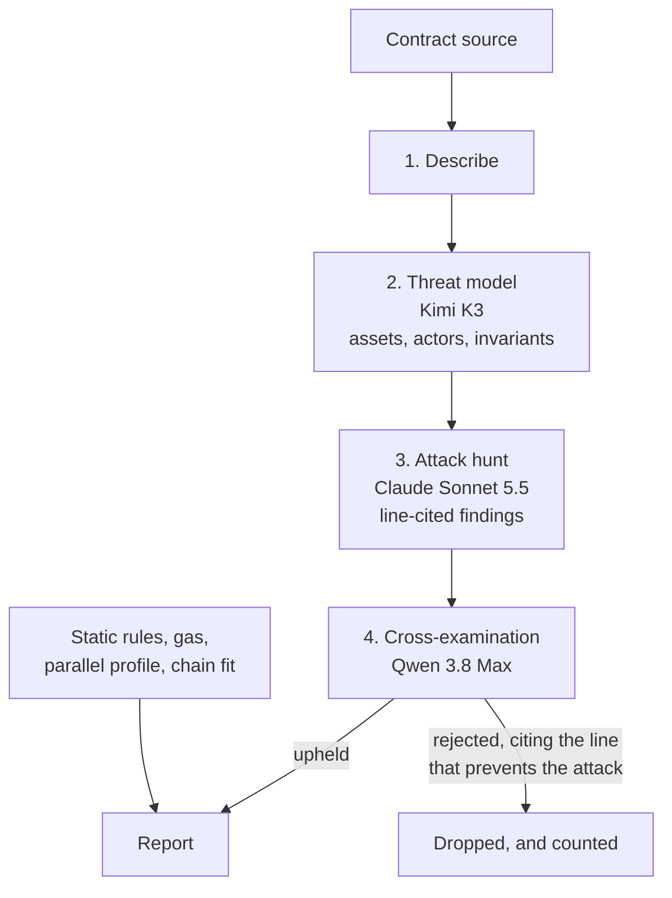

- **Kimi K3** (`moonshotai/kimi-k3`) writes the threat model: from the contract's own assets, actors and invariants, what an attacker would go after and how. The hunt tests it and the review judges against it, so it shapes the whole audit. [Article](https://www.monsmith.com/learn/kimi-k3-writes-the-threat-model).
- **Qwen 3.8 Max** (`qwen/qwen3.8-max-0902`) cross-examines every finding. It may only reject a finding by citing the line that prevents the attack. Every report names the model and how many findings it upheld and rejected, and that record is inside the attested report hash, on Monad. [Article](https://www.monsmith.com/learn/qwen-3-8-max-cross-examines-audit-findings).

- **Masked findings.** The hunt also reports issues that only become reachable once another one is fixed (one bug often hides the next), and each names the finding that blocks it.
- **After a fix**, the same invariants Kimi K3 derived from the original contract are checked against the new code. An invariant counts as broken only with a cited line and the calls that break it, and the reviewer still judges it.

**Proof:** MyToken's live report: Kimi K3 threat model with 5 threats tested; Qwen 3.8 Max upheld 2 findings and rejected 0; score 85, attested in [`0x1a295209…bcfc`](https://monadvision.com/tx/0x1a295209f50c6a47ea6ca0cc26db496ac814ff78631288c92c63f97e6420bcfc).

**Code:** `lib/report/audit.ts` (`THREAT_MODELS`, `AUDIT_MODELS`, `REVIEW_MODELS`), `lib/report/verification.ts`

---

### Best Community Team Project

Monsmith is built by Adwait Keshari, a member of **PU DAO**.

---

## Build on Monsmith: verify before you call

**HTTP.** Open and CORS-enabled. Look up by source hash, or by chain and address:

```sh
curl "https://www.monsmith.com/api/verify?source=0x55f6d6e8ea0c86f866b403bf5e3c36e66afa253f78cbf41f300bed9b7418c9c4"
```

```json
{
  "attested": true,
  "agent": { "agentId": "10332", "registry": "eip155:143:0x8004A169FB4a3325136EB29fA0ceB6D2e539a432" },
  "contract": "0xfa57831fcb96effc1e36d41e44cd0fb1ac16de77",
  "attestation": {
    "sourceHash": "0x55f6d6e8ea0c86f866b403bf5e3c36e66afa253f78cbf41f300bed9b7418c9c4",
    "score": 85, "critical": 0, "high": 0, "medium": 3, "low": 2,
    "reportHash": "0x79a18b6f4024e40a747fe99c2f47ac0ccef9b71af1f0315a40e2f3ee96ea78e6",
    "reportURI": "https://www.monsmith.com/report/0a29280e-19f7-46c1-b58c-3a046601c5e6",
    "attestedAt": "2026-10-11T10:59:50.000Z"
  },
  "reportMatches": true
}
```

**Solidity.** Gate a call on a Chainlink-confirmed audit:

```solidity
interface IMonsmithVerdicts {
    function isConfirmed(bytes32 sourceHash, uint8 minScore) external view returns (bool);
}

IMonsmithVerdicts constant MONSMITH = IMonsmithVerdicts(0x37c8ced74d81b7c6aa8515b0cc0798bb6d4bd2bc);

function callAudited(address target, bytes32 sourceHash, bytes calldata data) external {
    require(MONSMITH.isConfirmed(sourceHash, 70), "not audited to 70+");
    (bool ok, ) = target.call(data);
    require(ok);
}
```

Or read Monsmith's own record directly: `MonsmithAttestations.ofSource(sourceHash)` and `ofDeployment(chainId, target)`.

**Agents** discover Monsmith the ERC-8004 way, through its registration file at [`/agent.json`](https://www.monsmith.com/agent.json).

---

## Onchain proof, Monad mainnet

Chain id 143.

| What | Address or transaction |
| --- | --- |
| ERC-8004 Identity Registry | `0x8004A169FB4a3325136EB29fA0ceB6D2e539a432` |
| Monsmith agent | #10332, registered in [`0x6a00adf9…b029`](https://monadvision.com/tx/0x6a00adf97b62936058afa9db34e51c176c2fc46c98d1b8b6de61b8be9136b029), held by the Dynamic MPC wallet [`0x37E6Be20…A683`](https://monadvision.com/address/0x37E6Be20e5cad8701c0355B38Bc955C46CcCa683) since [`0x700c0568…dc64`](https://monadvision.com/tx/0x700c05686de63291bcf98570dfb61f1ba6d991dbe59ece32a80f92cdd089dc64) |
| MonsmithAttestations | [`0xfa57831Fcb96Effc1E36d41e44Cd0fb1aC16de77`](https://monadvision.com/address/0xfa57831Fcb96Effc1E36d41e44Cd0fb1aC16de77), deployed in [`0x51d10ff7…02a2`](https://monadvision.com/tx/0x51d10ff77c933e4ada65a71fafbcdb23b1abe5197f1c82ee85c4ea917d0d02a2) at block 112,388,073 |
| MonsmithVerdicts (Chainlink CRE receiver) | [`0x37c8ced74d81b7c6aa8515b0cc0798bb6d4bd2bc`](https://monadvision.com/address/0x37c8ced74d81b7c6aa8515b0cc0798bb6d4bd2bc), deployed in [`0xf1d955d8…79ec`](https://monadvision.com/tx/0xf1d955d869dce9912b2db1d3c5405b8c64ee359e8821258e1da0f8955b8579ec) |
| Privy embedded wallet deploy | `MyToken` [`0xe4eA06e0…Ce74`](https://monadvision.com/address/0xe4ea06e01ca0b4cb4044527bdae1de1ecbe7ce74) in [`0xfe9c2aa5…449d`](https://monadvision.com/tx/0xfe9c2aa54f60264a37f07a570d94fd3899191ed145704ed93bfb0ccf494f449d) |

**All 11 attestations.** The five reference contracts, each before and after Monsmith's optimizer, and a fresh audit published from the studio:

| Contract | Original | Optimized |
| --- | --- | --- |
| The DAO (rebuilt) | 39, [`0x89ef26f5…41c3`](https://monadvision.com/tx/0x89ef26f578557606b3f960182ab4879cbe3caa9d51cec7cbb5be1c6fdafc41c3) | **79**, [`0xd16adc9f…0393`](https://monadvision.com/tx/0xd16adc9f7ddf741b0f64a342a01e085cdebbe3017d9c94e56a42f2ffdb940393) |
| Uniswap v2 pair | 52, [`0x7a4c3ff2…d42a`](https://monadvision.com/tx/0x7a4c3ff2c869913c31f235b6b820ddcb059d2ac8ed213a5540b009ae931fd42a) | 53, [`0x20ec2813…a5ee`](https://monadvision.com/tx/0x20ec28132af0b14d49d1e59bcd3c17cad404a399f0abc349ce03f6e6474da5ee) |
| Uniswap v3 pool | 53, [`0x5a13e549…c093`](https://monadvision.com/tx/0x5a13e549367736b2cccfe6545b71bf370cde5465e1df31f28b75ccff2f06c093) | 64, [`0xb813ecf9…daf4`](https://monadvision.com/tx/0xb813ecf9375f0d325352d6eb8080751ac45fa00d3a8359a3dec2bc43eee3daf4) |
| WETH9 | 73, [`0xc21cfd4a…43a2`](https://monadvision.com/tx/0xc21cfd4ae2cd23a4a93d5afabb0749e73e28db11feceb9542b8da3217eb243a2) | 74, [`0x6de0b9ac…9e28`](https://monadvision.com/tx/0x6de0b9ac57fa0230edb6068530a5f43637d0fce96edae162f3eb4c4cafa49e28) |
| Compound COMP | 80, [`0xab4d0b82…dac9`](https://monadvision.com/tx/0xab4d0b82a3e007c4c91f1586c76f6dc411e237456b8c32167863b19426fd9ac9) | 81, [`0xf94ecd88…d7eb`](https://monadvision.com/tx/0xf94ecd88fd182cd94a7178c8ca4631bdaeefffca63ea0582fa0eb2f849ead7eb) |
| MyToken, from the studio, signed by the Dynamic wallet | 85, [`0x1a295209…bcfc`](https://monadvision.com/tx/0x1a295209f50c6a47ea6ca0cc26db496ac814ff78631288c92c63f97e6420bcfc) | |

---

## Repository map

```text
app/
  studio/            the IDE: editor, Contract Report, optimizer, deploy
  verify/            public verify page and the Envio-backed ledger
  github/            the pull request review page, with its live numbers
  open/              opens Mera-sealed reports in the browser
  api/verify/        verify by source hash or by chain + address (Alchemy proxy checks)
  api/attestations/  the ledger, from Envio HyperIndex with HyperSync fallback
  api/report/        reports, sharing, attestation (Dynamic signer)
  api/github/webhook/ the GitHub App's deliveries: pull request reviews and installs
  api/stake/         Nansen "What is at stake"
  api/auth/session/  Privy identity token to HttpOnly session
  agent.json/        ERC-8004 registration file
lib/
  report/            the four-pass audit (Kimi K3, Claude, Qwen 3.8 Max), scoring, fix review
  prReview/          pull request review: fix tracking, the comment, check runs, attest on merge
  attest/            signer (Dynamic), RPC (Alchemy), ledger (Envio)
  auth/              Privy client and server
  seal/              Mera sealed reports
  stake/             Nansen Profiler client
contracts/
  attest/            MonsmithAttestations.sol
  cre/               MonsmithVerdicts.sol and the CRE receiver template
cre/                 Chainlink CRE workflow (attestation-verifier)
indexer/             Envio HyperIndex indexer
scripts/             ERC-8004 setup, verdicts deploy, Dynamic wallet, identity move
tests/               336 unit tests
```

---

## Tech stack

| Layer | Choices |
| --- | --- |
| App | Next.js 16 (App Router), React 19, TypeScript strict, Tailwind, Monaco editor, React Three Fiber for the landing hero |
| Compile and measure | solc-js (version from the pragma), an in-process EVM for gas and cross-chain cost, a storage-dependency parser for Monad's parallel execution |
| AI | OpenRouter: Kimi K3 (threat model), Claude Sonnet 5.5 (hunt, optimize), Qwen 3.8 Max (review), fast models for description |
| Accounts and keys | Privy (sign-in + embedded wallets), Dynamic (MPC agent wallet), Mera (passkey-sealed reports) |
| Chain | viem, Alchemy with public RPC fallback, Solidity 0.8.24 with Hardhat, ERC-8004 Identity Registry on Monad mainnet |
| Indexing and orchestration | Envio HyperIndex 3.14 over HyperSync, Chainlink CRE TypeScript SDK 1.23 with CRE CLI 1.36 |
| Data and business | Neon Postgres, Nansen Profiler API, Dodo Payments for card checkout, PostHog |

---

## What existed before Metropolis and what was built during it

The commit history is the original history, unedited. Everything up to **30 Aug 2026** (`5ac5a17`) existed before the build window:

- the browser IDE (editor, multi-file projects, compile and deploy to Monad testnet and mainnet);
- the contract template library;
- the pattern-based security checks;
- the parallel-execution profiler and its benchmark harness;
- the usage analytics;
- the PyMon Python-to-Solidity transpiler;
- the Monsmith landing page.

Built from **1 Sep 2026** onward, during the window:

- **Measurement and compilation:** Chain Fit (per-function cost across six EVM chains, measured by running the contract), any-version solc with flattening, workspace persistence.
- **The Contract Report:** the four-pass threat-model audit that replaced the checklist; report history, redaction and sharing; PDF and Markdown downloads.
- **Sources and access:** GitHub App import, including private repositories; accounts (Clerk at first, replaced by Privy on 11 Oct 2026).
- **The studio and Aria:** the redesign that cut the toolbar from 17 controls to 4; Aria, the assistant that has read the open file.
- **Payments:** two free reports, then Dodo card checkout.
- **The optimizer:** fix-review scoring, before and after diffs, the five reference contracts with instant playback.
- **Trust layer:** ERC-8004 identity and onchain attestations, the `/verify` page and API.
- **Every sponsor integration:** Qwen 3.8 Max review, Kimi K3 threat models, the Envio indexer and ledger, Alchemy RPC and proxy-aware checks, the Chainlink CRE verifier and `MonsmithVerdicts`, the Dynamic MPC agent wallet, Privy accounts with embedded wallets, Mera sealed reports, and Nansen's "What is at stake".

---

## Run it

```sh
npm install
cp .env.example .env.local   # every section says whether it is optional
npm run dev                  # http://localhost:3000
```

Audits need `OPENROUTER_API_KEY` and `DATABASE_URL`. Everything else is optional, and the feature it controls hides itself when unset.

Onchain identity, once, from a funded wallet:

```sh
npx hardhat compile
node scripts/erc8004-setup.mjs          # registers the ERC-8004 agent, deploys MonsmithAttestations
node scripts/deploy-verdicts.mjs        # deploys MonsmithVerdicts for the CRE workflow
```

Indexer: [`indexer/README.md`](indexer/README.md). CRE workflow: [`cre/README.md`](cre/README.md).

## Tests

```sh
npm run test:unit                       # 336 tests: audit, reports, pull request review, payments, attestations, ledger, RPC, sealing
npx hardhat test                        # contracts, including MonsmithAttestations and MonsmithVerdicts
cd indexer && pnpm test                 # Envio handlers
cd cre/attestation-verifier && bun test # CRE workflow
```

## AI tools used

- **Inside the product:** Kimi K3 (threat models), Claude Sonnet 5.5 (finding vulnerabilities, optimizing), Qwen 3.8 Max (reviewing findings), and DeepSeek V4.1 Flash with other fast models (describing contracts), all through OpenRouter. Each report says which models wrote its threat model and checked its findings.
- **Building the product:** Claude Code (Anthropic) was used as a coding assistant throughout development, under the author's direction and review.

## Attribution

- Reference contracts in `public/samples/` are copied unchanged at pinned commits and keep their own licences: Uniswap v2 and v3, canonical WETH9, Compound COMP. The DAO is a rebuild of slock.it's original. See `public/samples/README.md`.
- `contracts/cre/ReceiverTemplate.sol`, `IReceiver.sol` and `IERC165.sol` come from the Chainlink CRE templates (MIT). The bindings in `cre/contracts/evm/ts/generated/` are generated by the CRE CLI.
- The ERC-8004 registries are the shared deployments on Monad mainnet.
- OpenZeppelin Contracts are bundled for in-browser compilation (MIT).

See [`NOTICE`](NOTICE). Licensed under [Apache-2.0](LICENSE).

## Author

Built solo by [Adwait Keshari](https://x.com/AdwaitKeshari) ([GitHub](https://github.com/Adwaitbytes)).
