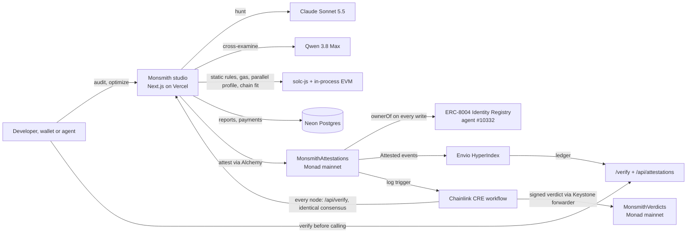

# Monsmith

An AI auditor agent for Monad that audits and fixes smart contracts, then attests every audit onchain under its ERC-8004 identity, so wallets and agents can check a contract before they call it.

- Live product: https://www.monsmith.com/studio
- Check any contract: https://www.monsmith.com/verify
- Agent registration file: https://www.monsmith.com/agent.json
- Verification API for agents: `GET https://www.monsmith.com/api/verify?chainId=143&address=0x...`

Licensed under Apache-2.0.

## Monad Blitz: Metropolis submission

**Track 04: Trust, Identity & AI Infrastructure.** Monsmith is a trust primitive other apps build on. An agent with its own ERC-8004 identity on Monad mainnet audits code and writes a signed record for each audit: the source hash, the score and the hash of the full report. Anyone can then verify that record with one contract read or one HTTP call. A Chainlink DON independently re-checks each record, and Envio indexes the full history.

Bounties entered, and where each one lives in the code:

| Bounty | What it does in Monsmith | Where |
| --- | --- | --- |
| **Qwen 3.8 Max** | Cross-examines every finding the hunting model produces. It may only reject a finding by citing the line that prevents the attack. The report names Qwen and says how many findings it upheld and rejected. | `lib/report/audit.ts` (review pass, `REVIEW_MODEL`), `lib/report/verification.ts`, shown in the report's Health section |
| **Envio** | A HyperIndex indexer over every `Attested` event since deployment, through HyperSync. It powers the live ledger on `/verify` and `/api/attestations`. The public Monad RPC serves `eth_getLogs` 100 blocks at a time, so without it the history cannot practically be read. | `indexer/`, `lib/attest/ledger.ts`, `app/api/attestations`, `app/verify/LedgerFeed.tsx` |
| **Chainlink CRE** | The orchestration layer for independent verification. A log trigger on Monad mainnet fires; the workflow reads the current attestation at finalized depth, has every node fetch `/api/verify` with identical consensus on whether the report still matches its hash, then makes a signed write to `MonsmithVerdicts` on Monad through the Keystone forwarder. | `cre/attestation-verifier/`, `contracts/cre/MonsmithVerdicts.sol` |
| **Alchemy** | The RPC behind the agent's onchain work: attestation writes, reads, and code checks on Monad, Ethereum and Sepolia, with the public endpoints as fallback. Before an audit is tied to a deployed address, Alchemy confirms code is there and reads the EIP-1967 slot. A proxy's score is never bound to its address, because its owner can repoint it. `/verify` resolves a proxy to the implementation it runs. | `lib/attest/rpc.ts`, `app/api/report/[id]/attest/route.ts`, `app/api/verify/route.ts` |

## The problem

Agents and wallets increasingly call contracts nobody on the team has read. The audit, if one exists at all, is a PDF on a website, and nothing ties it to the bytes being called. Two failures follow:

1. You cannot ask, at the moment of the call, whether this exact code was audited and how it scored.
2. You have to trust whoever published the audit not to edit it later.

## What Monsmith does

1. **Audit.** Paste a contract, import one by address, or pick a GitHub repository. The audit runs four passes:
   - Describe what the contract does.
   - Derive threats from its own assets and invariants.
   - Hunt for concrete, line-cited attacks (Claude Sonnet 5.5).
   - Have a different model family attack those findings (Qwen 3.8 Max).

   Alongside the AI passes run deterministic static rules, a parallel-execution profile for Monad, a gas table, and a cross-chain cost comparison measured by running the contract in an EVM.
2. **Fix.** "Optimize" rewrites the contract to fix the findings. A fix only counts if the result compiles and keeps its interface. It is then re-checked the way an audit firm runs a fix review: each earlier finding is confirmed fixed or still present, and new findings count only in the changed lines. Download the before and after as a diff.
3. **Attest.** "Publish to Monad" writes the score, severity counts, source hash and report hash to `MonsmithAttestations` on Monad mainnet. Only the wallet that owns ERC-8004 agent #10332 can write, and that ownership is checked on every write.
4. **Verify.** `/verify`, `/api/verify` and `MonsmithAttestations.ofDeployment` answer whether an address or a source was audited, and the score. The report is hashed again and compared, so an edited report shows up as edited. A Chainlink DON writes its own verdict to `MonsmithVerdicts`. A contract that wants more than Monsmith's word calls `isConfirmed(sourceHash, minScore)`.

## Architecture



## Onchain, Monad mainnet (chain 143)

| What | Address or transaction |
| --- | --- |
| ERC-8004 Identity Registry | `0x8004A169FB4a3325136EB29fA0ceB6D2e539a432` |
| Monsmith agent | #10332, registered in [`0x6a00adf9…b029`](https://monadvision.com/tx/0x6a00adf97b62936058afa9db34e51c176c2fc46c98d1b8b6de61b8be9136b029), agentURI https://www.monsmith.com/agent.json |
| MonsmithAttestations | [`0xfa57831Fcb96Effc1E36d41e44Cd0fb1aC16de77`](https://monadvision.com/address/0xfa57831Fcb96Effc1E36d41e44Cd0fb1aC16de77), deployed in [`0x51d10ff7…02a2`](https://monadvision.com/tx/0x51d10ff77c933e4ada65a71fafbcdb23b1abe5197f1c82ee85c4ea917d0d02a2) at block 112388073 |
| MonsmithVerdicts (CRE receiver) | Deployed with `scripts/deploy-verdicts.mjs`; address recorded in `cre/attestation-verifier/config.staging.json` |

The first ten attestations are the five starter contracts, each before and after Monsmith's optimizer:

| Contract | Original | Optimized |
| --- | --- | --- |
| The DAO (rebuilt) | 39, [`0x89ef26f5…41c3`](https://monadvision.com/tx/0x89ef26f578557606b3f960182ab4879cbe3caa9d51cec7cbb5be1c6fdafc41c3) | 79, [`0xd16adc9f…0393`](https://monadvision.com/tx/0xd16adc9f7ddf741b0f64a342a01e085cdebbe3017d9c94e56a42f2ffdb940393) |
| Uniswap v2 pair | 52, [`0x7a4c3ff2…d42a`](https://monadvision.com/tx/0x7a4c3ff2c869913c31f235b6b820ddcb059d2ac8ed213a5540b009ae931fd42a) | 53, [`0x20ec2813…a5ee`](https://monadvision.com/tx/0x20ec28132af0b14d49d1e59bcd3c17cad404a399f0abc349ce03f6e6474da5ee) |
| Uniswap v3 pool | 53, [`0x5a13e549…c093`](https://monadvision.com/tx/0x5a13e549367736b2cccfe6545b71bf370cde5465e1df31f28b75ccff2f06c093) | 64, [`0xb813ecf9…daf4`](https://monadvision.com/tx/0xb813ecf9375f0d325352d6eb8080751ac45fa00d3a8359a3dec2bc43eee3daf4) |
| WETH9 | 73, [`0xc21cfd4a…43a2`](https://monadvision.com/tx/0xc21cfd4ae2cd23a4a93d5afabb0749e73e28db11feceb9542b8da3217eb243a2) | 74, [`0x6de0b9ac…9e28`](https://monadvision.com/tx/0x6de0b9ac57fa0230edb6068530a5f43637d0fce96edae162f3eb4c4cafa49e28) |
| Compound COMP | 80, [`0xab4d0b82…dac9`](https://monadvision.com/tx/0xab4d0b82a3e007c4c91f1586c76f6dc411e237456b8c32167863b19426fd9ac9) | 81, [`0xf94ecd88…d7eb`](https://monadvision.com/tx/0xf94ecd88fd182cd94a7178c8ca4631bdaeefffca63ea0582fa0eb2f849ead7eb) |

The CRE workflow has been simulated against the first of these. Every node agreed The DAO's report is intact (see `cre/README.md`).

## Tech stack

- **App:** Next.js 16 (App Router) with React 19, TypeScript in strict mode, and Tailwind. Monaco is the editor, and React Three Fiber draws the landing hero.
- **Compilation and analysis:**
  - solc-js, with the compiler version chosen from the pragma.
  - An in-process EVM for gas and cross-chain measurements.
  - A storage-dependency parser for Monad's parallel execution.
- **AI:** OpenRouter. The hunt runs on Claude Sonnet 5.5, the review on Qwen 3.8 Max, and the describe and threat passes on fast models.
- **Data and accounts:** Neon Postgres, Clerk sign-in, Dodo Payments for card checkout, PostHog analytics.
- **Chain:**
  - viem.
  - Alchemy, with the public RPCs as fallback.
  - Solidity 0.8.24 contracts tested with Hardhat.
  - ERC-8004 Identity Registry on Monad mainnet.
- **Indexing:** Envio HyperIndex 3.14 over HyperSync.
- **Orchestration:** Chainlink CRE TypeScript SDK 1.23, simulated with CRE CLI 1.36.

## What existed before Metropolis and what was built during it

The commit history is the original history, unedited. Everything up to **30 Aug 2026** (`5ac5a17`) existed before the build window:

- the browser IDE (editor, multi-file projects, compile and deploy to Monad testnet and mainnet);
- the contract template library;
- the pattern-based security checks;
- the parallel-execution profiler and its benchmark harness;
- the usage analytics;
- the PyMon Python-to-Solidity transpiler;
- the Monsmith landing page.

Built from **1 Sep 2026** onward, during the window:

- **Measurement and compilation:**
  - Chain Fit (per-function cost across six EVM chains, measured by running the contract).
  - Any-version solc with flattening.
  - Workspace persistence.
- **The Contract Report:**
  - The four-pass threat-model audit that replaced the checklist.
  - Report history, redaction and sharing.
  - PDF and Markdown downloads.
- **Sources and access:**
  - GitHub App import, including private repositories.
  - Clerk accounts.
- **The studio and Aria:**
  - The studio redesign, which cut the toolbar from 17 controls to 4.
  - Aria, the assistant that has read the open file.
- **Payments:** two free reports, then Dodo card checkout.
- **The optimizer:**
  - Fix-review scoring.
  - Before and after diffs.
  - The five reference contracts, with instant playback.
- **Trust layer:**
  - ERC-8004 identity and onchain attestations.
  - The `/verify` page and API.
- **Bounty integrations:**
  - Qwen 3.8 Max as the reviewer.
  - The Envio indexer and ledger.
  - Alchemy RPC and proxy-aware code checks.
  - The Chainlink CRE verifier and `MonsmithVerdicts`.

## Run it

```sh
npm install
cp .env.example .env.local   # fill in what you need; every section says if it is optional
npm run dev                  # http://localhost:3000
```

Required to run audits: `OPENROUTER_API_KEY` and `DATABASE_URL`. Everything else is optional, and the feature it controls hides itself when unset.

Onchain identity, one time, from a funded wallet:

```sh
npx hardhat compile
node scripts/erc8004-setup.mjs          # registers the ERC-8004 agent and deploys MonsmithAttestations
node scripts/deploy-verdicts.mjs        # deploys MonsmithVerdicts for the CRE workflow
```

Indexer: see `indexer/README.md`. CRE workflow: see `cre/README.md`.

## Tests

```sh
npm run test:unit                       # 291 tests: audit, reports, payments, attestations, ledger, RPC
npx hardhat test                        # contracts, including MonsmithAttestations and MonsmithVerdicts
cd indexer && pnpm test                 # Envio handlers
cd cre/attestation-verifier && bun test # CRE workflow
```

## AI tools used

- **Inside the product:** Claude Sonnet 5.5 (finding vulnerabilities, optimizing), Qwen 3.8 Max (reviewing findings), and DeepSeek V4.1 Flash with other fast models (describing contracts and threats), all through OpenRouter. Each report says which model checked its findings.
- **Building the product:** Claude Code (Anthropic) was used as a coding assistant throughout development, under the author's direction and review.

## Attribution

- Reference contracts in `public/samples/` are copied unchanged at pinned commits and keep their own licences: Uniswap v2 and v3, canonical WETH9, Compound COMP. The DAO is a rebuild of slock.it's original. See `public/samples/README.md`.
- `contracts/cre/ReceiverTemplate.sol`, `IReceiver.sol` and `IERC165.sol` come from the Chainlink CRE templates (MIT). The bindings in `cre/contracts/evm/ts/generated/` are generated by the CRE CLI.
- The ERC-8004 registries are the shared deployments on Monad mainnet.
- OpenZeppelin Contracts are bundled for in-browser compilation (MIT).

See `NOTICE`.

## Author

Built by [Adwait Keshari](https://x.com/AdwaitKeshari), solo. GitHub: [Adwaitbytes](https://github.com/Adwaitbytes).
